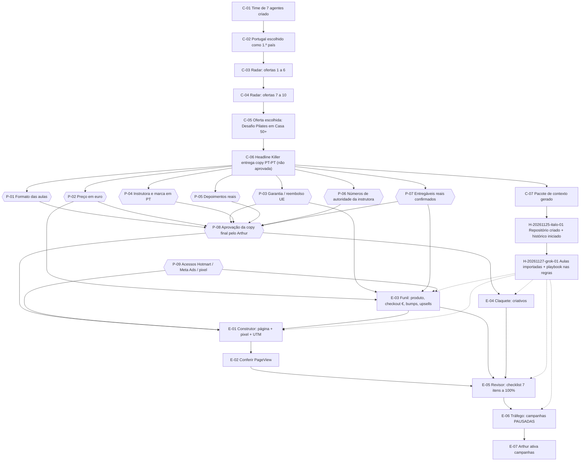

# Mapa de dependências entre ações

Este mapa mostra como cada ação se liga às outras: o que veio antes, o que está bloqueado e por quê. **Atualize-o a cada entrada nova do `CHANGELOG.md`** (regras em `AGENTS.md`).

Legenda dos nós:

| Prefixo | Significa |
|---|---|
| `C-NN` | Marco do **contexto original**, anterior a este repositório (fonte: `contexto/00-LEIA-PRIMEIRO.md`, secção 3). Não muda mais. |
| `H-...` | Entrada do `CHANGELOG.md`. |
| `P-NN` | **Pendência**: decisão ou acesso que falta. Bloqueia o que aponta para ela. |
| `E-NN` | **Etapa futura** do fluxo do time, ainda não feita. Quando acontecer, vira uma entrada `H-...` e aponta para cá. |

Setas: `A --> B` quer dizer **"B depende de A"** (A tem de existir ou estar resolvido antes de B). Seta tracejada (`-.->`) quer dizer **consulta**: B lê A quando acontecer, e A não desbloqueia B.

---

## Grafo

> O GitHub renderiza este bloco como diagrama. Num editor sem Mermaid, use a tabela abaixo, que tem a mesma informação.

---

## Tabela de nós

### Marcos do contexto original (fechados)

| Nó | O que foi | Depende de | Fonte |
|---|---|---|---|
| C-01 | Arthur pediu o time; coordenador criou os 7 agentes (secção "Direct Response" não foi criada). | — | `contexto/00-LEIA-PRIMEIRO.md` §2–3 |
| C-02 | Arthur escolheu Portugal. | C-01 | §3 item 3 |
| C-03 | Radar entregou ofertas 1–6 (~16:27). | C-02 | §3 item 6; `contexto/01-ofertas-radar.md` |
| C-04 | Radar entregou ofertas 7–10 (~16:50). | C-03 | §3 item 8 |
| C-05 | Arthur escolheu a oferta 10, Desafio Pilates em Casa 50+. | C-04 | §3 item 9; §4 |
| C-06 | Headline Killer entregou página adaptada, 10 headlines, 5 vídeos, 3 estáticas (~17:10). Copy **não aprovada**. | C-05 | `contexto/02-entrega-headline-killer.md` |
| C-07 | Pacote de contexto montado para a IA parceira (~20:58). | C-06 | §3 item 12 |

### Entradas do histórico

| Nó | Resumo | Continua | Depende de | Resolve | Abre |
|---|---|---|---|---|---|
| H-20261125-italo-01 | Repositório criado, contexto importado, sistema de histórico iniciado. | C-07 | — | — | P-01 a P-09 (registradas a partir do contexto) |
| H-20261127-grok-01 | 11 aulas e o playbook importados; agentes passam a consultá-los. Regras antigas mantidas; divergências anotadas em `AGENTS.md` §8. | H-20261125-italo-01 | — | — | — |

### Pendências

| Nó | Pendência | Estado | Quem decide | Bloqueia | Fonte |
|---|---|---|---|---|---|
| P-01 | Formato das aulas (`[FORMATO]`): ao vivo no fuso de Lisboa, gravadas, PDF + vídeos, instrutora em PT... | ⏳ aberta | Arthur | P-08 → E-01, E-04 | `00-LEIA` §5.1 |
| P-02 | Preço em euro (`[PREÇO]`). Referência 9,90–14,90 € (19,90 € citado como exemplo). Sem preço riscado. | ⏳ aberta | Arthur | P-08, E-03 | §5.2 |
| P-03 | Garantia / reembolso na UE (livre resolução de 14 dias ou regra explícita no checkout). | ⏳ aberta | Arthur | P-08, E-03 | §5.3 |
| P-04 | Quem assina a oferta em PT: Lays Trancoso / Lays Sant'anna ou instrutora e marca locais. | ⏳ aberta | Arthur | P-08 | §5.4 |
| P-05 | Depoimentos reais e autorizados para `[ESPAÇO PARA PROVA REAL]`. | ⏳ aberta | Arthur | P-08 | §5.5 |
| P-06 | Confirmar ou retirar "7 anos" e "20 mil mulheres 50+" (`[PROVA REAL A CONFIRMAR]`). | ⏳ aberta | Arthur | P-08 | §5.6 |
| P-07 | Entregáveis reais: gravações 12 meses, grupo WhatsApp, guia de compras. | ⏳ aberta | Arthur | P-08, E-03 | §5.7 |
| P-08 | Aprovação da copy final (depende de P-01 a P-07 preenchidas). | ⏳ aberta | Arthur | E-01, E-04 | §3 item 11; regra do Construtor |
| P-09 | Acessos à Hotmart, Meta Ads e pixel (ainda não pedidos nem configurados). | ⏳ aberta | Arthur / amigo | E-01, E-03 | §2 regras transversais |

Ao fechar uma pendência: troque `⏳ aberta` por `✅ resolvida em H-...` e, no grafo, adicione a seta `Hxx --> Pxx`.

### Etapas futuras

| Nó | Etapa | Agente | Depende de | Regra crítica |
|---|---|---|---|---|
| E-01 | Montar e publicar página com pixel e UTM | Construtor | P-08, P-09, E-03 (link do checkout). Consulta H-20261127-grok-01 (anatomia da página). | Só copy aprovada pelo Arthur. |
| E-02 | Conferir que o PageView dispara | Construtor / Revisor | E-01 | Antes de qualquer anúncio. Connect rate não substitui isto. |
| E-03 | Produto, checkout em €, bumps e upsells na Hotmart | Funil | P-02, P-03, P-07, P-09. Consulta H-20261127-grok-01 (esteira de upsell). | Preço só com ok do Arthur. |
| E-04 | Criativos (vídeo e imagem) | Claquete | P-08. Consulta H-20261127-grok-01 (gancho, corpo, CTA). | Sem prova social falsa nem claims proibidos. |
| E-05 | Revisão final, checklist de 7 itens | Revisor | E-02, E-03, E-04. Consulta H-20261127-grok-01 (10 dicas e funil de 5 etapas, como auditoria extra). | Só aprova a 100%, com evidência. |
| E-06 | Subir campanhas | Tráfego | E-05. Consulta H-20261127-grok-01 (CBO e Bid Cap, as duas escolas). | **Sempre pausadas**; conferir pela API. Quem ativa é o Arthur. |
| E-07 | Ativar campanhas | Arthur | E-06 | Só o Arthur ativa. |
