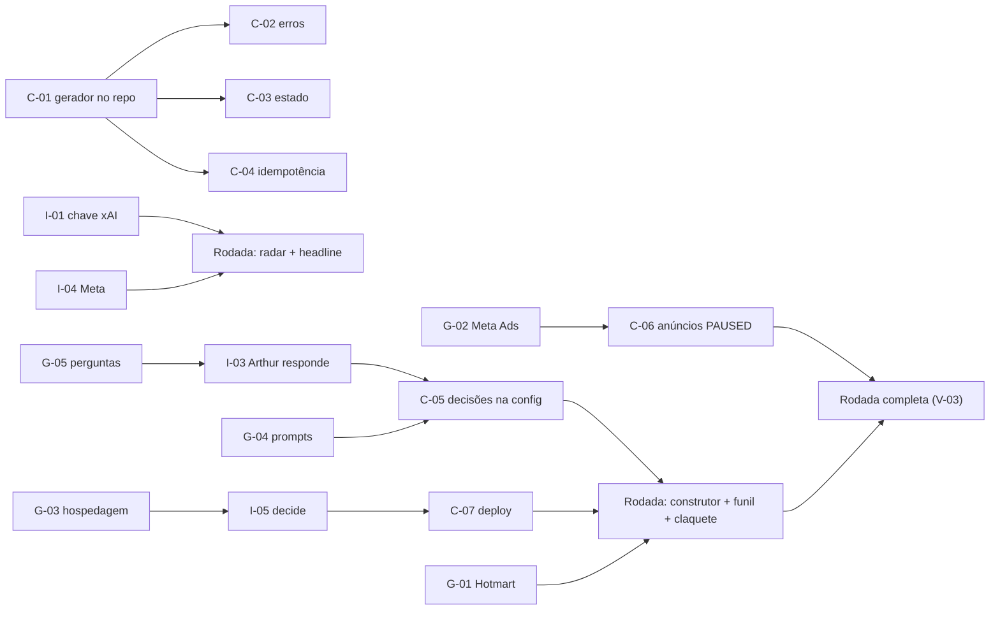

# Avaliação da estrutura e divisão de tarefas (Claude × Grok)

**Data:** 2026-11-27 (America/Bahia UTC-3) · **Entrada no histórico:** `H-20261127-italo-02`
**Para quem é:** o Italo, o Claude e o **Grok** (o assistente Grok que o Italo usa no PC, trabalhando em paralelo). Se você é o Grok, leia a seção 4 e depois pegue a sua primeira tarefa da seção 5.

> **Não confundir:** o "GROK BOT" citado em `plano/PLANO-DE-ACAO.md` é o **modelo `grok-4` dentro do n8n** (nós Agent do fluxo, chamados pela API da xAI). O "Grok" deste documento é o **assistente** que trabalha com o Italo no projeto. São coisas diferentes.

---

## 1. Resumo em 5 linhas

1. O desenho do fluxo está bom e documentado: 8 workflows no n8n, contrato de dados único, verificações por código que o supervisor Grok não consegue contornar, Tráfego travado em `PAUSED`.
2. A lógica dos nós Code funciona: em 2026-11-27 rodei `tools/checar.mjs` (8 workflows ok, 15 a 32 nós cada) e `tools/testar-codigos.mjs` ("TODOS OS TESTES PASSARAM") no PC do Italo.
3. **Nada foi testado com credencial real ainda.** As 3 credenciais `DR · ...` são placeholders (P-12), então nenhuma etapa rodou contra Meta, Hotmart ou xAI.
4. O maior risco hoje não é técnico: **as decisões do Arthur (P-01 a P-08) travam metade do fluxo**, e o código gerador **não tem controle de versão** (está fora deste repositório, dentro de uma pasta git de outro projeto).
5. Dá para acelerar em paralelo: o Claude trabalha no **código** (gerador e workflows), o Grok na **pesquisa de APIs, prompts e textos para o Arthur**, e o Italo destrava **credenciais e acessos**.

---

## 2. O que existe hoje

| Peça | Onde | Estado | Evidência |
|---|---|---|---|
| Regras para IAs | `AGENTS.md`, `CLAUDE.md` | ✅ completas | — |
| Histórico e mapa | `historico/` | ✅ em uso desde 25/11 (7 entradas) | `CHANGELOG.md` |
| Contexto da oferta Pilates 50+ | `contexto/` | ✅ congelado (não editar) | copy PT-PT **não aprovada** |
| Especificação técnica do fluxo | `plano/PLANO-DE-ACAO.md` | ✅ escrita em 27/11 | backlog D-01..08, T-01..09, V-01..04, tudo ⬜ |
| 8 workflows no n8n | n8n local do Italo (`localhost:5678`, v2.46.4) | ✅ importados, sub-workflows publicados | `H-20261125-italo-03` |
| Gerador (`gerar.mjs`, `prompts.mjs`, `codigos.mjs`, `checar.mjs`, `testar-codigos.mjs`) + JSON dos workflows | PC do Italo, `Downloads\claude\automacoes\direct-response-n8n\` | ✅ funciona; ⚠️ **fora do repositório** | testes de 27/11 acima |
| Credenciais `DR · xAI Grok`, `DR · Meta`, `DR · Hotmart` | n8n | ⛔ placeholders | P-12 |
| `pixel_id`, `ad_account_id`, produto e checkout Hotmart | — | ⛔ não existem ainda | P-09 |
| Domínio e hospedagem da página | — | ⛔ não decidido | D-07 |

## 3. Lacunas e riscos (por ordem de impacto)

| # | Risco / lacuna | Impacto | O que resolve | Dono |
|---|---|---|---|---|
| R-1 | Decisões do Arthur (formato, preço, garantia, instrutora, depoimentos, números, entregáveis, aprovação da copy) estão abertas desde 25/11 | Construtor, Funil, Claquete, Revisor e Tráfego nunca passam | D-05, D-06, D-08 | Arthur (Grok prepara as perguntas, G-05) |
| R-2 | Gerador sem controle de versão: está numa pasta que é um repositório git **de outro projeto** (com centenas de arquivos apagados pendentes). Um commit errado ali mistura tudo; um disco perdido apaga o gerador | perder o fluxo inteiro; a outra máquina não tem a fonte | T-01 | Claude |
| R-3 | Nenhuma credencial real; nenhuma chamada de API foi validada (o endpoint de produtos da Hotmart está "a confirmar") | primeiro teste real pode quebrar várias etapas de uma vez | D-01..D-03 + pesquisa G-01/G-02 | Italo + Grok |
| R-4 | Falha do modelo (401/limite/timeout da xAI) derruba a rodada inteira sem aviso | rodada "some" sem relatório | T-02 | Claude |
| R-5 | Copy é regerada a cada rodada; o Construtor pode publicar texto que o Arthur não aprovou | violação da regra "só copy aprovada" | T-03 | Claude |
| R-6 | Tráfego roda duas vezes = campanhas duplicadas; anúncios ainda não são criados | gasto/confusão na conta; fluxo incompleto | T-07, T-06 | Claude (com pesquisa G-02) |
| R-7 | Publicação da página é manual; não há domínio | Construtor sempre reprova na 1.ª rodada | D-07 → T-05 | Italo + Arthur decidem, Grok compara (G-03), Claude implementa |
| R-8 | O Claude ainda não grava direto no GitHub (Claude GitHub App não instalada, P-11); tudo passa pelo navegador do PC | cada registro é lento e depende do PC ligado | P-11 | Italo |
| R-9 | Duas IAs no mesmo repositório podem editar o mesmo arquivo ao mesmo tempo | conflito / trabalho perdido | regras da seção 4 | todos |

---

## 4. Como Claude e Grok trabalham juntos (regras de convivência)

1. **Os dois seguem o `AGENTS.md`**: ler as 5 últimas entradas do `historico/CHANGELOG.md` e o `historico/MAPA-DEPENDENCIAS.md` antes de agir; registrar entrada depois.
2. **IDs de entrada por autor-IA, para não colidir:** o Claude usa `H-AAAAMMDD-italo-NN` (como até agora); o Grok usa **`H-AAAAMMDD-grok-NN`**, com `Autor: italo — Grok`.
3. **Cada um tem os seus arquivos** (ninguém edita o arquivo do outro sem combinar):

   | Dono | Arquivos |
   |---|---|
   | Claude | `n8n/**` (o gerador, quando vier para o repo pela T-01), os workflows no n8n do Italo, `plano/PLANO-DE-ACAO.md` (seções técnicas 1 a 14) |
   | Grok | `plano/pesquisa/**` (pesquisas de API, comparações) e `plano/rascunhos/**` (prompts propostos, textos para o Arthur) |
   | Ambos (só acrescentar no topo) | `historico/CHANGELOG.md`, `historico/MAPA-DEPENDENCIAS.md`, tabela de status da seção 5 deste arquivo |

4. **O Grok não mexe no n8n nem no gerador.** Proposta de mudança de prompt ou de nó vai como texto em `plano/rascunhos/`; o Claude leva para o gerador (a fonte da verdade, regra 2 da seção 16 do plano).
5. **Entrega do Grok:** se o Grok consegue abrir PR no GitHub, abre PR com o arquivo e a entrada `H-...-grok-NN`. Se não consegue, o Grok entrega o texto pronto ao Italo, que cola na conversa do Claude, e o Claude grava no repositório e registra a entrada em nome do Grok.
6. **Sem segredos, nunca** (o repositório é público): nada de chave, token, senha, `client_secret`, `pixel_id`, `ad_account_id`, link de convite ou dado pessoal em nenhum arquivo, nem em exemplo.
7. **Sem inventar dados:** o que o Grok não confirmar numa documentação oficial sai marcado como **não verificado**, com o link de onde procurou.
8. **Status:** ao começar uma tarefa, troque ⬜ por 🟡 na seção 5; ao terminar, ✅ + data + ID da entrada.

---

## 5. Divisão de tarefas

Legenda: ⬜ a fazer · 🟡 em andamento · ✅ feito · ⛔ bloqueado. "Liga a" aponta para o backlog do `PLANO-DE-ACAO.md` (seção 15).

### 5.1 Claude (código, n8n, repositório)

| # | Tarefa | Liga a | Depende de | Status | Data | Entrada |
|---|---|---|---|---|---|---|
| C-01 | Trazer o gerador para `n8n/` neste repositório (sem credenciais; conferir que nenhum JSON tem valor de segredo) e registrar V-01 | T-01, V-01 | — | ✅ | 2026-11-27 | H-20261127-italo-03 |
| C-02 | Workflow `99 Erros` + retries nos nós Agent e HTTP | T-02 | C-01 | 🟡 código pronto; falta publicar no n8n | 2026-11-27 | H-20261127-italo-04 |
| C-03 | Persistir estado entre rodadas e congelar a copy aprovada (hash + versão) | T-03 | C-01 | 🟡 código pronto; falta publicar no n8n | 2026-11-27 | H-20261127-italo-05 |
| C-04 | Idempotência do Tráfego (procurar campanha por nome) + paginação da Ad Library | T-07 | C-01 | 🟡 código pronto; falta publicar no n8n | 2026-11-27 | H-20261127-italo-06 |
| C-05 | `config.decisoes` e `criativos_aprovados` no gerador, usando os prompts revisados pelo Grok | T-04 | G-04, D-05 | ⛔ | | |
| C-06 | Imagens da Claquete guardadas + `adimages` → `adcreative` → `ads` **PAUSED** no Tráfego | T-06 | G-02, D-02, D-04 | ⛔ | | |
| C-07 | Nó de deploy da página | T-05 | G-03, D-07 | ⛔ | | |
| C-08 | Rodadas de teste com credenciais reais, etapa por etapa | V-02 | D-01..D-04 | ⛔ | | |

### 5.2 Grok (pesquisa, prompts, textos)

| # | Tarefa | Entrega (arquivo) | Liga a | Status | Data | Entrada |
|---|---|---|---|---|---|---|
| G-01 | **Hotmart API hoje:** confirmar na documentação oficial o fluxo OAuth (`client_credentials`), o endpoint que lista produtos e o que dá para ler de checkout/oferta (preço, moeda). Para cada endpoint: URL, método, headers, exemplo de resposta (com valores fictícios), link da doc. Dizer o que a API **não** faz | `plano/pesquisa/hotmart-api.md` | seção 9 do plano, T-08 | ✅ | 2026-11-27 | `H-20261127-grok-02` |
| G-02 | **Meta Marketing API v23:** passo a passo para criar `adimages` → `adcreative` (link da página com UTMs) → `ads` com `status: PAUSED`; campos obrigatórios; como buscar campanha por nome (para idempotência); limites conhecidos da Ad Library API fora da UE | `plano/pesquisa/meta-ads-api.md` | T-06, T-07 | ✅ | 2026-11-27 | `H-20261127-grok-03` |
| G-03 | **Hospedagem da página:** comparar 2 ou 3 opções com API de deploy (Netlify e Render já estão ligados ao GitHub do Italo; incluir também uma opção estática simples). Critérios: custo, domínio próprio com HTTPS, deploy por API a partir do n8n, tempo até ficar no ar. Terminar com uma recomendação | `plano/pesquisa/hospedagem.md` | D-07, T-05 | ✅ | 2026-11-27 | `H-20261127-grok-04` |
| G-04 | **Revisar os prompts dos agentes** (`n8n/tools/prompts.mjs`, depois da C-01): PT-PT ("para si", nunca "você"), regras de saúde da Meta, nada de prova social inventada; e escrever a versão do prompt do Headline Killer que recebe `config.decisoes` (formato, preço, garantia, instrutora, depoimentos, números, entregáveis) | `plano/rascunhos/prompts-revisados.md` | T-04 | ✅ | 2026-11-27 | `H-20261127-grok-06` |
| G-05 | **Perguntas para o Arthur:** uma mensagem curta, em PT-BR, que o Italo possa mandar, com P-01 a P-08 e D-08 em formato de múltipla escolha quando der (ex.: preço 9,90 / 12,90 / 14,90 €), e o que cada resposta destrava | `plano/rascunhos/perguntas-arthur.md` | D-05, D-06, D-08 | ✅ | 2026-11-27 | `H-20261127-grok-01` |
| G-06 | **Roteiro de testes do Revisor:** para cada um dos 7 itens do checklist, como quebrar de propósito e o que o Revisor deve responder | `plano/rascunhos/testes-revisor.md` | V-02 | ✅ | 2026-11-27 | `H-20261127-grok-05` |

**Ordem sugerida para o Grok:** G-05 (destrava o Arthur, o maior gargalo) → G-01 → G-02 → G-03 → G-06 → G-04.

### 5.3 Italo (acessos e decisões que só ele pode fazer)

| # | Tarefa | Liga a | Status |
|---|---|---|---|
| I-01 | Colar a chave da xAI na credencial `DR · xAI Grok` no n8n (nunca no chat nem no Git) | D-01, P-12 | ⬜ |
| I-02 | Instalar a Claude GitHub App em `italoxdemelo` com acesso a `direct-response` (o Claude passa a gravar sem o navegador) | P-11 | ⬜ |
| I-03 | Mandar ao Arthur as perguntas da G-05 e repassar as respostas | D-05, D-06, D-08 | ⬜ |
| I-04 | Com o Arthur: token de sistema da Meta, credenciais Hotmart, `pixel_id`, `ad_account_id` | D-02..D-04, P-09 | ⬜ |
| I-05 | Decidir hospedagem e domínio com base na G-03 | D-07 | ⬜ |

---

## 6. Caminho mais curto até a primeira rodada real

Com a chave da xAI e o token da Meta (I-01, I-04), o Radar e o Headline Killer já podem rodar de verdade **sem nenhuma decisão do Arthur**. É o primeiro teste real possível.
