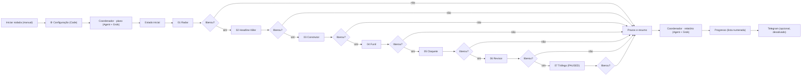

# Plano de ação técnico — fluxo Direct Response no n8n

**Para quem é:** qualquer IA (ou pessoa) que vá construir, corrigir ou operar o fluxo Direct Response no n8n. Leia isto inteiro antes de mexer em qualquer workflow.

**O que é:** a especificação de como cada etapa do fluxo **está construída hoje** e de como **deve ficar** para funcionar de ponta a ponta sem intervenção manual além das aprovações do Arthur. Para cada etapa: objetivo, gatilho, nós em ordem (tipo e configuração), entradas e saídas, credenciais, tratamento de erros, lacunas e como testar.

**Base:** os 8 workflows importados no n8n do Italo em 25–26/11/2026 (entrada `H-20261125-italo-03`) e o código que os gera, lido em 27/11/2026. Substitui a versão de 26/11 deste arquivo (`H-20261126-italo-02`), que era só uma lista de tarefas de gestão.

**Regras que não se negociam** (vêm do `AGENTS.md` e valem para qualquer mudança no fluxo):

1. Campanhas da Meta são criadas **sempre `PAUSED`**. Nenhum nó, agente ou IA ativa campanha, conjunto ou anúncio. Quem ativa é o Arthur, no Gerenciador de Anúncios.
2. Nunca inventar dados (números, preços, datas, depoimentos, contagens de anúncios). O que não foi verificado sai como `"não verificado"`.
3. Sem prova social falsa, sem preço riscado de valor nunca praticado, sem claims de saúde (cura, perda de peso numérica, antes/depois).
4. Preço, copy final, formato e garantia só com o ok do Arthur, registrado no histórico.
5. Nenhum segredo (chave, token, senha, client secret) entra neste repositório, nem dentro de JSON de workflow exportado.

---

## Sumário

1. [Ambiente e onde está cada coisa](#1-ambiente-e-onde-está-cada-coisa)
2. [Arquitetura geral](#2-arquitetura-geral)
3. [Contrato de dados (config, estado, saída de etapa)](#3-contrato-de-dados)
4. [Padrão comum de toda etapa](#4-padrão-comum-de-toda-etapa)
5. [00 Coordenador (GROK BOT)](#5-00-coordenador-grok-bot)
6. [01 Radar](#6-01-radar-minerador)
7. [02 Headline Killer](#7-02-headline-killer-copywriter)
8. [03 Construtor](#8-03-construtor-página)
9. [04 Funil (Hotmart)](#9-04-funil-hotmart)
10. [05 Claquete](#10-05-claquete-criativos)
11. [06 Revisor](#11-06-revisor)
12. [07 Tráfego](#12-07-tráfego-sempre-pausado)
13. [Tratamento de erros](#13-tratamento-de-erros)
14. [Testes e critério de "funcionando perfeitamente"](#14-testes-e-critério-de-funcionando-perfeitamente)
15. [Ordem de execução do plano (backlog)](#15-ordem-de-execução-do-plano)
16. [Regras para a IA que for mexer no fluxo](#16-regras-para-a-ia-que-for-mexer-no-fluxo)

---

## 1. Ambiente e onde está cada coisa

| Item | Valor |
|---|---|
| n8n | self-hosted, versão 2.46.4, `http://localhost:5678`, no PC "italakinho" (Windows) do Italo |
| Tag dos workflows | `Direct Response` (a API do n8n não cria pastas; a tag faz esse papel) |
| Prefixo dos nomes | `Direct Response · ` |
| Modelo do GROK BOT | `grok-4` (xAI), temperatura 0.2, nó `@n8n/n8n-nodes-langchain.lmChatXAiGrok` |
| Código-fonte gerador | `Downloads\claude\automacoes\direct-response-n8n\` no PC do Italo (ainda **fora** deste repositório, ver tarefa T-01) |
| Saída de páginas | `Downloads\claude\canal-dark-n8n\data\direct-response\<slug>\index.html` (pasta que o n8n consegue escrever) |

### 1.1 Workflows e IDs no n8n

IDs internos do n8n (não são segredo; servem para o `Execute Workflow` do coordenador achar cada etapa):

| Workflow | ID | Gatilho | Ativo? |
|---|---|---|---|
| `Direct Response · 00 Coordenador (GROK BOT)` | `WiHxKHcgbaLG7iFy` | Manual (`Iniciar rodada`) | não (roda manual) |
| `Direct Response · 01 Radar (minerador)` | `ZEwHqbQbTRpqwbZm` | Execute Workflow Trigger | sim (exigência do n8n 2.x para ser chamado) |
| `Direct Response · 02 Headline Killer (copywriter)` | `HcVTPRfIrVr5pEpS` | Execute Workflow Trigger | sim |
| `Direct Response · 03 Construtor (página)` | `dIRHcPq6GOQjGjlf` | Execute Workflow Trigger | sim |
| `Direct Response · 04 Funil (Hotmart)` | `4ZrBWdTNmlj5cnez` | Execute Workflow Trigger | sim |
| `Direct Response · 05 Claquete (criativos)` | `b0Mtxcsxf2hZPAQZ` | Execute Workflow Trigger | sim |
| `Direct Response · 06 Revisor` | `cqkhx6Mc2PENjylp` | Execute Workflow Trigger | sim |
| `Direct Response · 07 Tráfego (gestor, sempre PAUSADO)` | `8nsN0jKDEmNyID9M` | Execute Workflow Trigger | sim |

Os sub-workflows ficam publicados porque o n8n 2.x só deixa chamar sub-workflow publicado. Como o único gatilho deles é o `Execute Workflow Trigger`, eles **não disparam sozinhos**.

Configurações do coordenador: `executionOrder: v1`, `saveManualExecutions: true`, `callerPolicy: workflowsFromSameOwner`.

### 1.2 Credenciais (só nomes; os valores ficam no n8n)

| Nome no n8n | Tipo n8n | Usada em | O que precisa ter | Estado |
|---|---|---|---|---|
| `DR · xAI Grok` | `xAiApi` | todos os nós Grok; geração de imagem (05) | chave da API em console.x.ai | ⏳ placeholder (P-12) |
| `DR · Meta (token de sistema)` | `facebookGraphApi` | 01 (Ad Library), 03 e 06 (pixel), 07 (Marketing API) | token de **usuário do sistema** do Business Manager com `ads_management`, `ads_read`; acesso à Ad Library API (identidade verificada em facebook.com/ID); acesso ao pixel e à conta de anúncios | ⏳ placeholder (P-12) |
| `DR · Hotmart` | `httpCustomAuth` | 04 (token OAuth) | JSON com header `Authorization: Basic …` e query `client_id`, `client_secret` (Hotmart › Ferramentas › Credenciais de API) | ⏳ placeholder (P-12) |
| `Telegram account` | `telegramApi` | 00, nó opcional `Enviar no Telegram` (desativado) | token do bot + `chatId` no nó | opcional |

**Nunca** exporte workflow com credencial preenchida para este repositório. O `gerar.mjs` cria as credenciais só com textos `COLE_AQUI_...`.

---

## 2. Arquitetura geral



- O **coordenador** carrega a configuração, pede ao GROK BOT um plano da rodada e chama as 7 etapas **em sequência**, cada uma por um nó `Execute Workflow` (`waitForSubWorkflow: true`).
- Depois de cada etapa, um nó Code grava o resultado em `estado.<etapa>` e um `IF` decide: se `seguir === true`, vai para a próxima; se não, pula direto para o relatório.
- `seguir` é `true` quando a etapa foi **aprovada** ou **pulada de propósito** (fora de `etapas_ativas`). Etapa **bloqueada** (faltou pré-requisito) ou **reprovada** para o fluxo.
- No fim, o GROK BOT escreve o progresso em lista numerada, em português.

---

## 3. Contrato de dados

Tudo que trafega entre coordenador e etapas é **um único item** JSON com duas chaves: `config` e `estado`.

### 3.1 `config` (definido no nó `⚙️ Configuração` do coordenador)

| Campo | Tipo | Valor atual | Quem define | Usado por |
|---|---|---|---|---|
| `pais_origem` | ISO-2 | `BR` | fixo | 01 |
| `pais_destino` | ISO-2 | `PT` | Arthur | 01, 07 |
| `nome_pais` | texto | `Portugal` | Arthur | 02, 03, 04 |
| `idioma` | BCP-47 | `pt-PT` | Arthur | 02, 03, 06 |
| `moeda` | ISO-4217 | `EUR` | Arthur | 04 |
| `etapas_ativas` | lista | as 7 | operador | todas (pular etapa) |
| `termos_busca` | lista | `desafio pilates`, `pilates em casa`, `pilates mulheres 50` | Radar/Arthur | 01 |
| `ofertas_br[]` | lista de objetos `{nome, page_id_br, url_pagina, preco_br, anuncios_ativos_br, anuncio_mais_antigo_br, print_br}` | Pilates 50+ | Radar (prints) | 01 |
| `oferta_escolhida` | `{nome, slug, url_pagina_original}` | Pilates 50+, `pilates50-pt` | Arthur | 02–07 |
| `copy_aprovada` | bool | `false` | **só o Arthur** | 03, 05 |
| `preco_aprovado` | texto, ex. `'14,90 €'` | vazio | **só o Arthur** | 04, 06 |
| `entregaveis_confirmados` | lista | vazia | Arthur | 04 |
| `pixel_id` | texto | vazio | Arthur/Italo | 03, 06, 07 |
| `pasta_saida` | caminho Windows | pasta do n8n | Italo | 03 |
| `url_pagina_publicada` | URL | vazio | Italo, depois de publicar | 03, 06, 07 |
| `url_privacidade`, `url_termos` | URL | vazios | Italo | 03 |
| `hotmart_product_id` | texto | vazio | Arthur | 04 |
| `hotmart_checkout_url` | URL | vazio | Arthur | 04, 06 |
| `ad_account_id` | `act_<número>` | vazio | Arthur | 07 |
| `orcamento_diario_centavos` | inteiro | `1000` (valor de exemplo do gerador, **não aprovado**) | **só o Arthur** | 07 |
| `publico` | texto | `mulheres 50+ em Portugal` | Arthur | 07 |
| `modelo_imagem` | texto | `grok-2-image` | Italo | 05 |
| `prazos` | `{radar: 'AAAA-MM-DD', ...}` | vazios | Arthur | 00 |
| `graph_version` | texto | `v23.0` | Italo | 01, 03, 06, 07 |

`pixel_id`, `ad_account_id` e `hotmart_product_id` não são segredos, mas por cautela ficam **só no n8n**, porque este repositório é público.

### 3.2 `estado`

```json
{
  "plano_do_coordenador": "texto do GROK BOT",
  "inicio_rodada": "ISO-8601",
  "radar":      { "...saída de etapa..." },
  "headline":   { "..." },
  "construtor": { "..." },
  "funil":      { "..." },
  "claquete":   { "..." },
  "revisor":    { "..." },
  "trafego":    { "..." }
}
```

### 3.3 Saída de etapa (o que todo sub-workflow devolve)

```json
{
  "etapa": "construtor",
  "agente": "Construtor",
  "aprovado": true,
  "seguir": true,
  "pulada": false,
  "bloqueado": false,
  "motivo": "só em bloqueio/pulo",
  "faltando": ["só em bloqueio"],
  "falhas_automaticas": ["nomes das verificações que deram false"],
  "verificacoes": { "nome_da_verificacao": true },
  "avisos": { "chave": "texto" },
  "briefing_grok": "texto",
  "saida": { "...JSON do agente + dados gerados..." },
  "supervisor": { "aprovado": true, "nota": 0, "problemas": [], "orientacao_para_o_agente": "", "proximo_passo": "" },
  "em": "ISO-8601"
}
```

**Regra de aprovação (nó `Saída da etapa`):** `aprovado = supervisor.aprovado === true` **e** todas as `verificacoes` são `true` **e** (no Revisor) `saida.aprovado !== false`. O supervisor Grok sozinho não aprova nada.

---

## 4. Padrão comum de toda etapa

Todos os sub-workflows 01–07 seguem o mesmo esqueleto. As seções de cada etapa só descrevem o que muda.

| # | Nó | Tipo n8n (versão) | Configuração |
|---|---|---|---|
| 1 | `Entrada` | `executeWorkflowTrigger` (1.1) | `inputSource: passthrough` (recebe `{config, estado}`) |
| 2 | `Pré-requisitos` | `code` (2) | Lê `config` e `estado`. Se a etapa não está em `etapas_ativas` → `{ok:false, pulada:true}`. Senão monta a lista `faltando` e devolve `{ok: faltando.length===0, pulada:false, faltando}` |
| 3 | `Pode rodar?` | `if` (2.2) | condição booleana `{{ $json.ok }}` é `true` |
| 3b | `Bloqueado / pulada` | `code` (2) | saída `false` do IF. Devolve saída de etapa com `aprovado:false`, `seguir = pulada`, `motivo` |
| 4 | *integração* | `httpRequest` (4.2) e/ou Code | específica da etapa. Todo HTTP tem `timeout: 60000`, `onError: continueRegularOutput`, `alwaysOutputData: true`; os que leem páginas usam `fullResponse: true, neverError: true, responseFormat: text` |
| 5 | `Dados da etapa` | `code` | junta o resultado da integração em `{dados, verificacoes, avisos}` |
| 6 | `Grok (xAI)` | `lmChatXAiGrok` (1) | modelo `grok-4`, temperatura 0.2, credencial `DR · xAI Grok`. Ligado como `ai_languageModel` ao briefing e ao agente |
| 7 | `Grok · briefing` | `agent` (2.2) | system message = `supervisorBriefing(etapa)`; texto = config + estado (cortado em 6.000 chars) + dados (15.000 chars); `maxIterations: 4`. Saída: até 12 linhas numeradas |
| 8 | `Agente · <Nome>` | `agent` (2.2) | system message = prompt do agente (`tools/prompts.mjs`), sempre terminando em "Responda somente em JSON válido"; texto = briefing + config + `dados` (40.000 chars) |
| 9 | *pós-agente* | `code` (+ HTTP/arquivo) | `parseJSON` da saída do agente e verificações por código. Último nó da cadeia devolve `{saida, verificacoes, avisos?}` |
| 10 | `Grok · supervisão` | `agent` (2.2) + `Grok (xAI) supervisor` | system message = `supervisorRevisao(etapa)`; recebe dados brutos, verificações e saída. Responde JSON `{aprovado, nota, problemas, orientacao_para_o_agente, proximo_passo}`. **Não pode aprovar se alguma verificação falhou** |
| 11 | `Saída da etapa` | `code` | aplica a regra de aprovação da seção 3.3 e devolve a saída de etapa |

Também há um `stickyNote` "Sobre este agente" em cada workflow.

**Utilitários embutidos nos nós Code** (`UTIL` em `tools/codigos.mjs`):

- `parseJSON(s)`: tira cercas de markdown, recorta do primeiro `{` ao último `}`, faz `JSON.parse`; em erro devolve `{erro_parse:true, bruto}`.
- `textoDoHtml(html)`: tira `script`/`style`/tags e devolve texto.
- `PRECO_RISCADO`: regex para `<s>`, `<del>`, `line-through`, "de R$/€ X por".
- `CLAIMS_SAUDE`: regex para "antes e depois", "perca N kg", "cura", "resultado garantido", "últimas vagas".

---

## 5. 00 Coordenador (GROK BOT)

**Objetivo:** rodar o fluxo inteiro numa "rodada", parar na primeira etapa que não passou e entregar o progresso ao dono.

**Gatilho:** `manualTrigger` ("Iniciar rodada"). (Tarefa T-09: agendar com `scheduleTrigger` só depois que tudo estiver estável.)

| # | Nó | Tipo | Configuração / função |
|---|---|---|---|
| 1 | `Iniciar rodada` | `manualTrigger` | — |
| 2 | `⚙️ Configuração` | `code` | devolve o objeto `config` da seção 3.1. **Único lugar onde o operador edita valores** |
| 3 | `Coordenador · plano` | `agent` + `Grok (xAI)` | prompt `COORDENADOR_PLANO`: divide tarefas, prazos (ou "prazo sugerido"), dependências e decisões do dono; lista numerada |
| 4 | `Estado inicial` | `code` | `{config, estado:{plano_do_coordenador, inicio_rodada}}` |
| 5–25 | para cada etapa `NN · <Nome>` → `Estado · <Nome>` → `<Nome> liberou?` | `executeWorkflow` (1.2, `source: database`, `workflowId` por ID, `waitForSubWorkflow: true`) → `code` (copia o item anterior e grava `estado[etapa] = $json`) → `if` (`estado[etapa].seguir`) | saída `true` vai para a próxima etapa; saída `false` vai para `Prazos e resumo` |
| 26 | `Prazos e resumo` | `code` | por agente: status (`aprovado`, `bloqueado`, `pulada`, `reprovado`, `não começou`), prazo, `atrasado` (prazo vencido em UTC-3 e não aprovado), motivo |
| 27 | `Coordenador · relatório` | `agent` + `Grok (xAI) relatório` | prompt `COORDENADOR_RELATORIO`: lista numerada com status por agente, atrasos, o que depende do dono, próximo passo; lembra que nada foi ativado |
| 28 | `Progresso (lista numerada)` | `code` | texto final em `progresso` |
| 29 | `Enviar no Telegram (opcional)` | `telegram` (1.2) | **desativado**; `chatId` placeholder; texto `{{ $json.progresso }}` |

**Lacunas do coordenador:**

- **Estado não persiste entre rodadas.** Se a rodada pula o Headline Killer, o Construtor fica bloqueado porque `estado.headline` não existe. Ver T-03.
- Se um sub-workflow lançar erro (ex.: nó Agent falha com 401 da xAI), a execução inteira para e não sai relatório. Ver seção 13.

---

## 6. 01 Radar (minerador)

**Objetivo:** para cada oferta BR candidata, medir a concorrência no país de destino pela Ad Library API e classificar em "oportunidade clara", "concorrência existente" ou "inconclusiva".

**Pré-requisitos:** `termos_busca` ou `ofertas_br` não vazios; `pais_destino` preenchido.

**Integração:**

| Nó | Tipo | Configuração |
|---|---|---|
| `Consultas → itens` | `code` | um item por termo (`search_terms`, `search_type: KEYWORD_UNORDERED`) e um por `page_id_br` (`search_page_ids`), todos com `ad_reached_countries: [pais_destino]`, `ad_active_status: ACTIVE`, `ad_type: ALL`, `fields: id,page_id,page_name,ad_delivery_start_time,ad_snapshot_url,ad_creative_link_titles`, `limit: 200` |
| `Meta Ad Library · país de destino` | `httpRequest` GET `https://graph.facebook.com/{v}/ads_archive` | credencial Meta; query = `$json.qs` |
| `Dados da etapa` | `code` | por consulta: anúncios carregados, `contagem_e_minimo` (há `paging.next` → mais de 200), anúncio mais antigo carregado, top 15 anunciantes, 5 exemplos com link, `link_print` para a Biblioteca. Para o BR, só repassa o que veio em `ofertas_br` (senão `"não verificado"`) |

**Saída do agente (JSON):**
`{"ofertas":[{"nome","page_id_br","anuncios_ativos_br","anuncio_mais_antigo_br","concorrencia_destino":{"termos","anuncios_ativos","anunciantes","mais_antigo"},"classificacao","motivo","evidencias"}],"recomendacao","nao_verificado"}`

**Verificações por código:** `api_meta_destino_respondeu`, `saida_do_agente_em_json`.

**Limite conhecido:** a Ad Library API só devolve anúncios comerciais de países da UE. **Números do Brasil não vêm da API**: vêm dos prints (campo `ofertas_br`); sem print ficam "não verificado". Não tente contornar com scraping da Biblioteca.

**Lacunas:** só lê a primeira página (200 anúncios); para contagem exata, paginar `paging.next` até o fim (T-07). O Radar ainda não grava prints (o link `link_print` é para tirar à mão).

**Como testar:** com credencial Meta válida, rodar só `radar` (`etapas_ativas: ['radar']`) e conferir que `consultas_destino[*].erro` está vazio e que os números batem com a Biblioteca aberta no navegador.

---

## 7. 02 Headline Killer (copywriter)

**Objetivo:** adaptar a página de vendas original ao idioma e cultura do destino e escrever 10 headlines, 5 roteiros de vídeo e 3 briefings de imagem.

**Pré-requisitos:** `oferta_escolhida.url_pagina_original`, `idioma`.

**Integração:** `Página original · baixar` (`httpRequest` GET na URL original, resposta em texto) → `Dados da etapa` (texto da página até 25.000 chars + `riscos_detectados_na_original` pelas regex).

**Saída do agente (JSON):**
`{"idioma","pagina":[{"secao","texto"}],"headlines":[],"roteiros_video":[{"id","gancho","corpo","cta"}],"briefings_imagem":[{"id","titulo","texto_na_imagem","visual"}],"removido_por_risco":[],"pendencias_do_dono":[]}`

Regras no prompt: pt-PT com "para si/consigo", nunca "você"; `[ESPAÇO PARA PROVA REAL]` sem depoimento verificado; `[PREÇO]` enquanto não houver preço aprovado; botões com `{{CHECKOUT_URL}}`.

**Verificações por código:** `pagina_original_baixada` (texto > 500 chars), `saida_do_agente_em_json`, `sem_preco_riscado`, `sem_claims_de_saude_ou_escassez`, `dez_headlines`, `cinco_roteiros_video`, `tres_briefings_imagem`, `sem_voce_em_pt_pt` (só quando `idioma = pt-PT`).

**Lacunas (importantes):**

- O agente **não recebe as decisões do Arthur** (formato, preço, garantia, instrutora). Precisa receber `config.decisoes` com P-01 a P-07 para preencher os marcadores (T-04).
- A copy é gerada de novo a cada rodada (modelo não determinístico). A versão que o Arthur aprovou precisa ser **congelada** e reutilizada, senão o Construtor publica um texto que ninguém aprovou (T-03).
- A cópia de referência que o Arthur já viu está em `contexto/02-entrega-headline-killer.md`; a nova versão aprovada deve ir para fora de `contexto/` (que não se edita).

**Como testar:** rodar só `headline`, conferir as 8 verificações e ler a copy procurando "você", preço riscado e claims de saúde.

---

## 8. 03 Construtor (página)

**Objetivo:** transformar a copy aprovada numa página HTML única, injetar pixel e UTM, gravar no disco e conferir o PageView na página publicada.

**Pré-requisitos:** `copy_aprovada === true`; `estado.headline.saida` existe; `pixel_id`; `pasta_saida`.

**Nós depois do agente:**

| Nó | Tipo | Configuração |
|---|---|---|
| `Montar HTML final` | `code` | injeta o **Meta Pixel** (`fbq('init', pixel_id)` + `fbq('track','PageView')` + `<noscript>`) antes de `</head>` e o script **`dr-utm`** antes de `</body>`; troca `{{URL_PRIVACIDADE}}`/`{{URL_TERMOS}}`; calcula `arquivo = pasta_saida\<slug>\index.html` |
| `HTML → arquivo` | `convertToFile` (1.1) | `operation: toText`, `sourceProperty: html`, `fileName: index.html` |
| `Gravar index.html` | `readWriteFile` (1) | `operation: write`, `fileName = arquivo`, `onError: continueRegularOutput` |
| `Página publicada · baixar` | `httpRequest` GET `url_pagina_publicada` (ou `http://invalid.local` se vazio) | texto, `fullResponse`, `neverError` |
| `Pixel · último disparo` | `httpRequest` GET `graph.facebook.com/{v}/{pixel_id}?fields=name,last_fired_time,is_unavailable` | credencial Meta |
| `Conferência do PageView` | `code` | ver verificações |

O script `dr-utm` repassa `utm_source`, `utm_medium`, `utm_campaign`, `utm_content`, `utm_term`, `fbclid`, `src` e `sck` para todo `a.cta` e links com `hotmart`/`pay.`; se não houver `src`, usa `utm_source`; se não houver `sck`, monta `utm_source|utm_campaign|utm_content`.

**Saída do agente (JSON):** `{"html":"<!doctype html>...","titulo","observacoes"}`. O agente **não** coloca pixel nem UTM (o código injeta). Botões: `<a class="cta" href="{{CHECKOUT_URL}}">`. `<html lang>` do destino e `<meta name="viewport">`.

**Verificações por código:** `saida_do_agente_em_json`, `html_completo`, `pixel_injetado`, `pageview_injetado`, `utm_injetado`, `botoes_marcados_para_checkout`, `pagina_publicada_no_ar` (HTTP 200), `pixel_certo_na_pagina_publicada`, `pageview_na_pagina_publicada`, `utm_na_pagina_publicada`, `pixel_disparou_nos_ultimos_7_dias`.

**Lacunas:**

- **Publicação é manual.** O fluxo grava o HTML no disco; alguém sobe para o domínio e preenche `url_pagina_publicada`. Por isso a primeira rodada sempre reprova o Construtor. Falta um nó de deploy (T-05). Domínio e hospedagem ainda não foram definidos.
- O Construtor monta a página **antes** do Funil ter o link do checkout (os botões ficam com `{{CHECKOUT_URL}}`, e o Funil regrava depois). A ordem 03 → 04 funciona, mas a página publicada só fica certa depois do Funil.

**Como testar:** rodar `headline` + `construtor` com `copy_aprovada: true` e `pixel_id` de teste; abrir o `index.html` gerado, confirmar no Gerenciador de Eventos da Meta (aba Testar eventos) que o PageView chega; publicar, preencher a URL e rodar de novo até todas as 11 verificações ficarem `true`.

---

## 9. 04 Funil (Hotmart)

**Objetivo:** conferir produto e checkout na Hotmart, entregar a ficha de configuração do painel e colocar o link do checkout nos botões da página.

**Pré-requisitos:** `preco_aprovado`; `estado.construtor.saida.html`; `hotmart_checkout_url`; `hotmart_product_id`.

**Integração:**

| Nó | Tipo | Configuração |
|---|---|---|
| `Hotmart · token` | `httpRequest` POST `https://api-sec-vlc.hotmart.com/security/oauth/token?grant_type=client_credentials` | credencial `DR · Hotmart` (`httpCustomAuth`) |
| `Hotmart · produtos` | `httpRequest` GET `https://developers.hotmart.com/products/api/v1/products` | header `Authorization: Bearer {{access_token}}`. **Endpoint a confirmar na documentação atual da Hotmart** na primeira rodada com credencial real |
| `Checkout · conferir` | `httpRequest` GET `hotmart_checkout_url` | texto, `fullResponse`, `neverError` |
| `Dados da etapa` | `code` | acha o produto por `id` ou `ucode`; status HTTP do checkout; aviso se o preço não aparece no HTML (a Hotmart desenha o preço por JavaScript) |

**Nós depois do agente:** `Link do checkout nos botões` (troca todo `{{CHECKOUT_URL}}` do HTML do Construtor pela URL do checkout) → `HTML → arquivo` → `Regravar index.html` → `Conferência pós-agente`.

**Saída do agente (JSON):**
`{"produto":{"nome","formato","preco","moeda","garantia"},"checkout":{"url","idioma","verificado"},"order_bumps":[{"nome","preco","status"}],"upsells":[...],"passos_no_painel":[],"pendencias":[]}`

**Verificações por código:** `hotmart_api_autenticou`, `produto_existe_na_hotmart`, `checkout_no_ar`, `saida_do_agente_em_json`, `botoes_com_link_do_checkout`, `sem_preco_riscado_na_ficha`, `pagina_regravada_no_disco`.

**Limite conhecido:** a API pública da Hotmart **não cria** produto, checkout, order bump nem upsell. Isso é feito no painel pelo Arthur, seguindo `passos_no_painel`. O fluxo só confere.

**Lacunas:** o HTML regravado precisa ser publicado de novo (mesma lacuna do deploy, T-05). Falta conferir o preço no checkout com um navegador headless, já que o HTML não traz o preço (T-08).

**Como testar:** com credencial real, rodar `funil` e conferir `hotmart_api_autenticou` e `produto_existe_na_hotmart`; abrir o checkout no navegador e conferir preço, moeda e idioma; conferir no `index.html` que não sobrou `{{CHECKOUT_URL}}`.

---

## 10. 05 Claquete (criativos)

**Objetivo:** transformar roteiros e briefings aprovados em imagens geradas e planos de vídeo.

**Pré-requisitos:** `copy_aprovada === true`; `estado.headline.saida`.

**Nós depois do agente:**

| Nó | Tipo | Configuração |
|---|---|---|
| `Imagens → itens` | `code` | até 6 imagens do plano do agente; prompt + `Text on image: "<texto>"` |
| `xAI · gerar imagem` | `httpRequest` POST `https://api.x.ai/v1/images/generations` | credencial `DR · xAI Grok`; body `{model: modelo_imagem, prompt, n:1, response_format:'url'}` |
| `Conferência pós-agente` | `code` | junta URLs e erros |

**Saída do agente (JSON):**
`{"imagens":[{"id","prompt","texto_na_imagem","formato"}],"videos":[{"id","duracao_s","cenas":[{"t","visual","texto_tela","locucao"}],"trilha"}]}`

Regras: prompt em inglês, texto da imagem no idioma do destino; formatos 1:1, 4:5, 9:16; sem antes/depois, sem corpo "transformado", sem claim de saúde.

**Verificações por código:** `tem_roteiros`, `saida_do_agente_em_json`, `imagens_geradas` (todas com URL), `videos_roteirizados`.

**Lacunas:**

- As URLs devolvidas pela xAI podem expirar. As imagens precisam ser **baixadas e guardadas** (disco ou storage) antes do Tráfego usá-las (T-06).
- Vídeos só saem roteirizados; o render fica com o gerador que o time escolher (decisão pendente).
- Falta a aprovação dos criativos pelo Arthur como campo da config (`criativos_aprovados`), no mesmo modelo de `copy_aprovada` (T-04).

**Como testar:** rodar `claquete` e abrir cada URL; conferir texto na imagem em pt-PT e ausência de claims.

---

## 11. 06 Revisor

**Objetivo:** só aprovar com 100%: checklist automático de 7 itens mais revisão de idioma e coerência pelo agente.

**Pré-requisitos:** `url_pagina_publicada`, `hotmart_checkout_url`, `pixel_id`.

**Integração:** `Revisor · página no ar` (GET página, texto) → `Revisor · checkout` (GET checkout) → `Revisor · pixel` (Graph API `last_fired_time`) → `Dados da etapa`.

**Checklist automático (cada item é uma verificação):**

| Item | Regra |
|---|---|
| `1_pagina_no_ar` | HTTP 200 |
| `2_pixel_certo_e_pageview` | `fbq('init', '<pixel_id>')` e `fbq('track','PageView')` no HTML publicado |
| `3_pixel_ja_disparou` | `last_fired_time` existe |
| `4_links_de_checkout_certos_e_no_ar` | há links de checkout, todos com a mesma base de `hotmart_checkout_url`, sem `{{CHECKOUT_URL}}`, checkout responde 200 |
| `5_preco_aprovado_e_sem_preco_riscado` | número do `preco_aprovado` aparece no texto e não há preço riscado |
| `6_idioma_do_destino` | `<html lang>` começa com o idioma do destino; em pt-PT, sem "você" |
| `7_criativos_prontos` | todas as imagens da Claquete têm URL |

**Saída do agente (JSON):** `{"aprovado","erros":[{"onde","trecho","problema","correcao"}],"comentario"}`.

**Verificações por código:** os 7 itens + `saida_do_agente_em_json` + `revisor_aprovou` (`aprovado === true` e nenhum erro).

**Lacunas:** o Revisor confere a página só pelo HTML; não roda JavaScript, então não vê o preço desenhado pelo checkout nem confere o PageView em navegador real (T-08). O item 7 deve passar a exigir `criativos_aprovados` (T-04).

**Como testar:** quebrar de propósito cada item (tirar o pixel, trocar o link, colocar "você") e confirmar que o Revisor reprova com a evidência certa.

---

## 12. 07 Tráfego (sempre PAUSADO)

**Objetivo:** criar na conta de anúncios a campanha de vendas e os conjuntos, **todos `PAUSED`**, e conferir pela API.

**Pré-requisitos:** `estado.revisor.aprovado === true` **na mesma rodada**; `ad_account_id` no formato `act_<número>`; `pixel_id`; `orcamento_diario_centavos > 0`.

**Nós depois do agente:**

| Nó | Tipo | Configuração |
|---|---|---|
| `Payload PAUSADO` | `code` | campanha `{name, objective: OUTCOME_SALES, buying_type: AUCTION, special_ad_categories: [], is_adset_budget_sharing_enabled: false, status: PAUSED}`; até 3 conjuntos `{status: PAUSED, daily_budget, billing_event: IMPRESSIONS, optimization_goal: OFFSITE_CONVERSIONS, bid_strategy: LOWEST_COST_WITHOUT_CAP, promoted_object: {pixel_id, custom_event_type: PURCHASE}, targeting: {geo_locations.countries:[pais_destino], age_min, age_max, genders?, targeting_automation.advantage_audience: 0}}`. **Trava:** se o JSON tiver qualquer `status` diferente de `PAUSED` ou a palavra `ACTIVE`, lança erro e nada é enviado |
| `Meta · criar campanha (PAUSED)` | `httpRequest` POST `/{v}/{ad_account_id}/campaigns` | body = campanha com `status: 'PAUSED'` reforçado na expressão |
| `Conjuntos → itens` | `code` | um item por conjunto com `campaign_id` |
| `Meta · criar conjunto (PAUSED)` | `httpRequest` POST `/{v}/{ad_account_id}/adsets` | `status: 'PAUSED'` reforçado |
| `IDs criados` | `code` | lista campanha + conjuntos |
| `Meta · reforçar PAUSED` | `httpRequest` POST `/{v}/{id}` | body `{status: 'PAUSED'}` para cada ID |
| `Meta · conferir status` | `httpRequest` GET `/{v}/{id}?fields=id,name,status,effective_status` | — |
| `Conferência PAUSADO` | `code` | reprova se algum `status ≠ PAUSED` ou `effective_status` fora de `PAUSED`, `CAMPAIGN_PAUSED`, `ADSET_PAUSED` |

**Saída do agente (JSON):** `{"campanha_nome","conjuntos":[{"nome","idade_min","idade_max","generos","observacao"}],"observacoes"}`. Nome padrão: `DR | <oferta> | <país> | <data>`. O agente **não escolhe status**.

**Verificações por código:** `campanha_criada`, `conjuntos_criados`, `tudo_pausado_conferido_na_api`.

**Lacunas:**

- **Os anúncios não são criados.** Falta: subir as imagens (`/{act}/adimages`), criar `adcreative` com link da página + UTMs, e criar `ads` com `status: PAUSED`, passando pela mesma trava e conferência (T-06).
- Se a rodada roda duas vezes, cria campanhas duplicadas. Falta checar por nome antes de criar (idempotência, T-07).
- O `orcamento_diario_centavos: 1000` é valor de exemplo do gerador; **só o Arthur define** (tarefa de decisão D-08).

**Como testar:** só com conta de anúncios de teste ou com o Arthur ciente; conferir no Gerenciador de Anúncios que tudo está pausado e apagar o que for de teste.

---

## 13. Tratamento de erros

**Como está hoje:**

- Todo `httpRequest` usa `onError: continueRegularOutput` + `alwaysOutputData: true`: uma API fora do ar não derruba a etapa; o erro vira dado e a verificação correspondente fica `false`.
- Respostas do agente que não são JSON viram `{erro_parse: true}` e reprovam `saida_do_agente_em_json`.
- O Tráfego tem uma trava que **lança erro** se aparecer status diferente de `PAUSED` (é de propósito: melhor parar do que arriscar).
- Os nós Agent (Grok) **não** têm `onError`: chave inválida, limite de uso ou timeout da xAI derrubam a execução inteira.

**Como deve ficar (T-02):**

1. Criar `Direct Response · 99 Erros` com `errorTrigger`, que monta mensagem (workflow, nó, erro, link da execução) e envia pelo Telegram (ou outro canal decidido). Configurar como *Error workflow* em todos os 8 workflows.
2. Nos nós Agent: `retryOnFail: true`, `maxTries: 3`, `waitBetweenTries: 5000`; depois disso, `onError: continueErrorOutput` levando para um Code que devolve saída de etapa reprovada com `motivo: 'falha do modelo'`.
3. Nos HTTP da Meta e da Hotmart: `retryOnFail` para 429/5xx; 4xx não repete.
4. Nunca colocar `retryOnFail` nos POST de criação do Tráfego sem antes ter a checagem de duplicidade (T-07).

---

## 14. Testes e critério de "funcionando perfeitamente"

**Ferramentas que já existem** (em `automacoes/direct-response-n8n/tools/`, no PC do Italo):

```powershell
node tools/testar-codigos.mjs   # roda a lógica dos nós Code com dados simulados
node tools/checar.mjs           # sintaxe dos nós Code, nomes duplicados, $('Nó') que não existe, conexões quebradas
node tools/gerar.mjs            # regenera os JSON e republica no n8n pelo nome (precisa de N8N_API_KEY no ambiente)
```

**Ordem de teste com credenciais reais** (uma etapa por vez, usando `etapas_ativas`):

1. `radar` → 2. `headline` → 3. `headline,construtor` → 4. publicar a página → 5. `construtor` de novo até PageView → 6. `funil` → 7. `claquete` → 8. `revisor` → 9. `trafego` (com o Arthur ciente).

**O fluxo está "funcionando perfeitamente" quando, numa única rodada com tudo ativo:**

1. As 7 etapas saem `aprovado: true`, sem nenhuma verificação `false`.
2. O PageView aparece no Gerenciador de Eventos vindo da URL publicada.
3. A página publicada tem o preço aprovado, o idioma pt-PT, os botões levam ao checkout em EUR com as UTMs.
4. Campanha, conjuntos e anúncios existem na conta **todos pausados**, conferidos pela API e no Gerenciador.
5. Uma segunda rodada igual **não** duplica nada.
6. Um erro forçado (ex.: chave da xAI errada) gera alerta no canal de erros, e não uma execução silenciosa.
7. O relatório numerado chega ao canal combinado.

---

## 15. Ordem de execução do plano

Marque o status ao concluir e registre a entrada `H-...` no `historico/CHANGELOG.md`. Status: ⬜ a fazer · 🟡 em andamento · ✅ feito · ⛔ bloqueado.

### 15.1 Decisões e acessos (bloqueiam testes reais)

| # | Item | Pendência | Quem | Status | Feito por | Data | Evidência |
|---|---|---|---|---|---|---|---|
| D-01 | Preencher `DR · xAI Grok` | P-12 | Italo | ⬜ | | | |
| D-02 | Preencher `DR · Meta (token de sistema)` com as permissões da seção 1.2 | P-09, P-12 | Arthur + Italo | ⬜ | | | |
| D-03 | Preencher `DR · Hotmart` | P-09, P-12 | Arthur + Italo | ⬜ | | | |
| D-04 | `pixel_id` e `ad_account_id` na config | P-09 | Arthur | ⬜ | | | |
| D-05 | Decisões da oferta: formato, preço, garantia, instrutora, depoimentos, números, entregáveis | P-01 a P-07 | Arthur | ⬜ | | | |
| D-06 | Aprovar a copy (`copy_aprovada`) | P-08 | Arthur | ⬜ | | | |
| D-07 | Domínio e hospedagem da página | — | Italo + Arthur | ⬜ | | | |
| D-08 | Orçamento diário e público de teste | — | Arthur | ⬜ | | | |

### 15.2 Construção (o que falta no fluxo)

| # | Tarefa | Workflow | Depende de | Status | Feito por | Data | Evidência |
|---|---|---|---|---|---|---|---|
| T-01 | Trazer o código gerador (`tools/`, `workflows/*.json` sem credenciais) para este repositório em `n8n/`, para a outra máquina e a outra IA terem a mesma fonte | todos | — | ⬜ | | | |
| T-02 | Workflow `99 Erros` + retries (seção 13) | todos | — | ⬜ | | | |
| T-03 | Persistir estado entre rodadas (n8n Data Table ou arquivo JSON por oferta) e **congelar a copy aprovada** (hash + versão); Construtor e Claquete leem a versão congelada, não a da rodada | 00, 02, 03, 05 | — | ⬜ | | | |
| T-04 | Levar as decisões do Arthur para a config (`decisoes: {formato, preco, garantia, instrutora, ...}`) e para o prompt do Headline Killer; criar `criativos_aprovados` | 00, 02, 05, 06 | D-05 | ⬜ | | | |
| T-05 | Nó de deploy da página (API da hospedagem escolhida) que preenche `url_pagina_publicada` sozinho, depois do Construtor e de novo depois do Funil | 03, 04 | D-07 | ⬜ | | | |
| T-06 | Baixar e guardar as imagens da Claquete; no Tráfego, criar `adimages` → `adcreative` → `ads` **PAUSED**, com UTMs no link, passando pela trava e pela conferência | 05, 07 | D-02, D-04 | ⬜ | | | |
| T-07 | Idempotência: Tráfego procura campanha pelo nome antes de criar; Radar pagina a Ad Library até o fim | 01, 07 | — | ⬜ | | | |
| T-08 | Conferência em navegador real (headless) para PageView e preço no checkout | 04, 06 | T-05 | ⬜ | | | |
| T-09 | Agendamento (`scheduleTrigger`) e envio do relatório pelo Telegram | 00 | T-02 | ⬜ | | | |

### 15.3 Validação

| # | Teste | Depende de | Status | Feito por | Data | Evidência |
|---|---|---|---|---|---|---|
| V-01 | `testar-codigos.mjs` e `checar.mjs` sem erro | T-01 | ⬜ | | | |
| V-02 | Rodada etapa por etapa (seção 14) com credenciais reais | D-01 a D-04 | ⬜ | | | |
| V-03 | Rodada completa cumprindo os 7 critérios da seção 14 | todas as T e D | ⬜ | | | |
| V-04 | Arthur ativa as campanhas no Gerenciador (fora do fluxo) | V-03 | ⬜ | | | |

---

## 16. Regras para a IA que for mexer no fluxo

1. Siga o `AGENTS.md`: leia o histórico antes, registre entrada depois.
2. **A fonte da verdade é o gerador** (`tools/gerar.mjs`, `tools/prompts.mjs`, `tools/codigos.mjs`). Mudou um nó no editor do n8n? Leve a mudança para o gerador, senão o próximo `gerar.mjs` apaga o que você fez.
3. Mantenha os **nomes dos nós**: os nós Code se referem uns aos outros por `$('Nome do nó')`. Renomeou, rode `checar.mjs`.
4. Toda etapa nova ou alterada segue o padrão da seção 4 e devolve a saída de etapa da seção 3.3.
5. Nenhum caminho do fluxo pode resultar em campanha, conjunto ou anúncio com status diferente de `PAUSED`. Qualquer nó novo de criação na Meta passa pela trava e pela conferência.
6. Não ponha valor de credencial, token ou ID de conta em nó, prompt, sticky note, commit ou mensagem.
7. Não troque `copy_aprovada`, `preco_aprovado`, `criativos_aprovados` nem orçamento: são do Arthur.
8. Ao terminar uma tarefa T/D/V, marque na tabela da seção 15 com quem fez, data e a entrada `H-...`.
